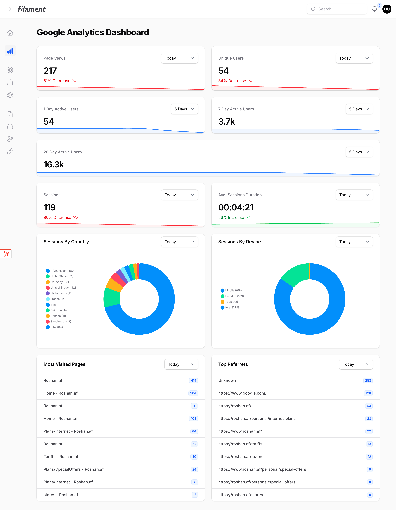
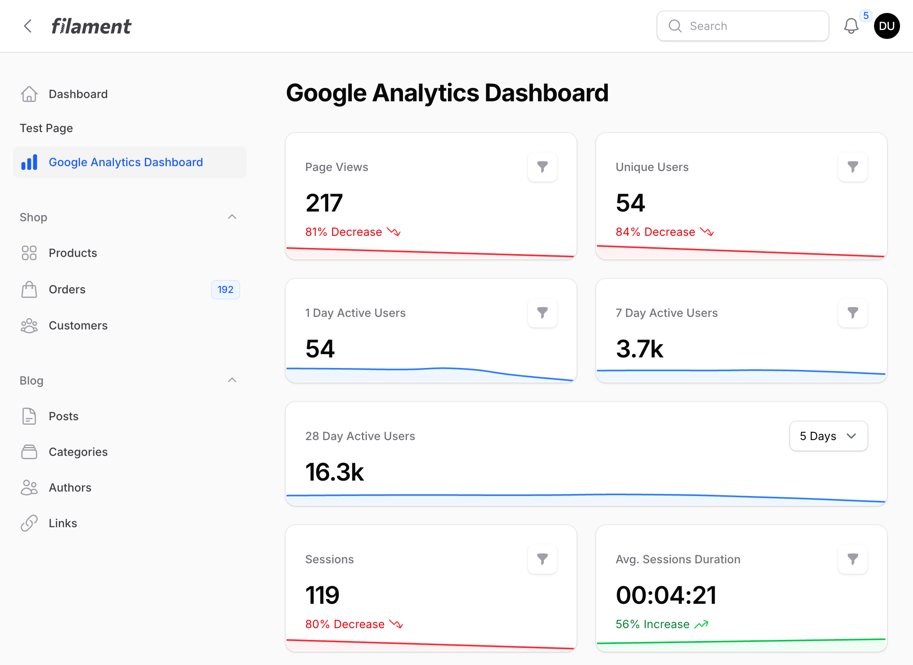

<a href="https://github.com/bezhansalleh/filament-google-analytics" class="filament-hidden">

</a>

<p align="center" class="flex items-center justify-center">
    <a href="https://filamentphp.com/docs/4.x/introduction/overview">
        
    </a>
    <a href="https://filamentphp.com/docs/5.x/introduction/overview">
        
    </a>
    <a href="https://packagist.org/packages/bezhansalleh/filament-google-analytics">
        
    </a>
    <a href="https://github.com/bezhansalleh/filament-google-analytics/actions?query=workflow%3Arun-tests+branch%3Amain" class="filament-hidden">
        
    </a>
    <a href="https://github.com/bezhansalleh/filament-google-analytics/actions/workflows/laravel-pint.yml?query=branch%3Amain" class="filament-hidden">
        
    </a>

<a href="https://packagist.org/packages/bezhansalleh/filament-google-analytics">
    
    </a>
</p>

# Google Analytics (GA4)

Bring your Google Analytics 4 data into [Filament Panels](https://filamentphp.com). The plugin ships a dedicated dashboard page and a set of widgets that show page views, visitors, sessions, active users, devices, countries, top pages and referrers, each with its own period filter.

## Table of Contents

- [Compatibility](#compatibility)
- [Installation](#installation)
- [Configuration](#configuration)
- [Usage](#usage)
  - [Dedicated Dashboard](#dedicated-dashboard)
  - [Available Widgets](#available-widgets)
  - [Widget Visibility](#widget-visibility)
  - [Custom Dashboard](#custom-dashboard)
- [Preview](#preview)
- [Upgrading](#upgrading)
- [Testing](#testing)
- [Changelog](#changelog)
- [Contributing](#contributing)
- [Security Vulnerabilities](#security-vulnerabilities)
- [Credits](#credits)
- [License](#license)

## Compatibility

| Package Version | Filament Version |
|-----------------|------------------|
| [1.x](https://github.com/bezhanSalleh/filament-google-analytics/tree/1.x) | [2.x](https://filamentphp.com/docs/2.x/admin/installation) |
| [2.x](https://github.com/bezhanSalleh/filament-google-analytics/tree/2.x) | [3.x](https://filamentphp.com/docs/3.x/panels/installation) |
| **3.x** | [4.x](https://filamentphp.com/docs/4.x/introduction/overview) & [5.x](https://filamentphp.com/docs/5.x/introduction/overview) |

## Installation

Install the package with Composer:

```bash
composer require bezhansalleh/filament-google-analytics
```

The plugin reads your analytics data through [Spatie's Laravel Analytics package](https://github.com/spatie/laravel-analytics). Follow its guide to create a service account and download the credentials, then place the file at:

```
storage/app/analytics/service-account-credentials.json
```

Add your GA4 property ID to your `.env` file:

```ini
ANALYTICS_PROPERTY_ID=
```

> [!IMPORTANT]
> The plugin follows Filament's theming rules. Create a [custom theme](https://filamentphp.com/docs/4.x/styling/overview#creating-a-custom-theme) if you haven't already, then add the following lines to your theme's CSS file:

```css
@source '../../../../vendor/bezhansalleh/filament-google-analytics/resources/views/**/*';
@source '../../../../vendor/bezhansalleh/filament-google-analytics/src/{Widgets,Support}/*';
```

Register the plugin in your panel provider:

```php
use BezhanSalleh\GoogleAnalytics\GoogleAnalyticsPlugin;

public function panel(Panel $panel): Panel
{
    return $panel
        ->plugins([
            GoogleAnalyticsPlugin::make(),
        ]);
}
```

## Configuration

Publish the config file to change the defaults:

```bash
php artisan vendor:publish --tag=google-analytics-config
```

The config file lets you:

- Enable or disable the dedicated dashboard page and set its navigation icon.
- Control where each widget appears through its `filament_dashboard` and `global` options. See [Widget Visibility](#widget-visibility).
- Change the icons and colors the stat widgets use for upward, downward and steady trends.

## Usage

### Dedicated Dashboard

The plugin registers a **Google Analytics** page in your panel's navigation and renders every widget on it. Set `dedicated_dashboard` to `false` in the config file to remove the page.

### Available Widgets

```php
use BezhanSalleh\GoogleAnalytics\Widgets;

Widgets\PageViewsWidget::class,
Widgets\VisitorsWidget::class,
Widgets\ActiveUsersOneDayWidget::class,
Widgets\ActiveUsersSevenDayWidget::class,
Widgets\ActiveUsersTwentyEightDayWidget::class,
Widgets\SessionsWidget::class,
Widgets\SessionsByCountryWidget::class,
Widgets\SessionsDurationWidget::class,
Widgets\SessionsByDeviceWidget::class,
Widgets\MostVisitedPagesWidget::class,
Widgets\TopReferrersListWidget::class,
```

### Widget Visibility

Each widget has two options in the config file:

| Option | Effect |
|--------|--------|
| `filament_dashboard` | Show the widget on Filament's default dashboard. Off by default. |
| `global` | Show the widget on the dedicated dashboard and on any other page where you register it. |

Set `filament_dashboard` to `true` for every widget you want on Filament's own dashboard.

### Custom Dashboard

The dedicated dashboard is a plain Filament page. To change its navigation label or group, pick a subset of widgets, or apply any other customization, disable the dedicated dashboard and create your own page:

```bash
php artisan make:filament-page MyCustomDashboardPage
```

Register the widgets you want in `getHeaderWidgets()` or `getFooterWidgets()`:

```php
<?php

namespace App\Filament\Pages;

use BezhanSalleh\GoogleAnalytics\Widgets;
use Filament\Pages\Page;

class MyCustomDashboardPage extends Page
{
    protected static ?string $navigationIcon = 'heroicon-o-document-text';

    protected string $view = 'filament.pages.my-custom-dashboard-page';

    protected function getHeaderWidgets(): array
    {
        return [
            Widgets\PageViewsWidget::class,
            Widgets\VisitorsWidget::class,
            Widgets\ActiveUsersOneDayWidget::class,
            Widgets\ActiveUsersSevenDayWidget::class,
            Widgets\ActiveUsersTwentyEightDayWidget::class,
            Widgets\SessionsWidget::class,
            Widgets\SessionsByCountryWidget::class,
            Widgets\SessionsDurationWidget::class,
            Widgets\SessionsByDeviceWidget::class,
            Widgets\MostVisitedPagesWidget::class,
            Widgets\TopReferrersListWidget::class,
        ];
    }
}
```

## Preview

The widgets rendered on the dedicated dashboard. They look the same on any page you add them to.




## Upgrading

When you upgrade from 2.x to 3.x, replace the `BezhanSalleh\FilamentGoogleAnalytics` namespace with `BezhanSalleh\GoogleAnalytics` everywhere you reference the plugin.

## Testing

```bash
composer test
```

## Changelog

See [CHANGELOG](CHANGELOG.md) for the list of recent changes.

## Contributing

If you want to contribute to this package, test it in a real Filament project:

- Fork this repository to your GitHub account.
- Create a Filament app locally.
- Clone your fork in your Filament app's root directory.
- In the `/filament-google-analytics` directory, create a branch for your fix, e.g. `fix/error-message`.

Install the package in your app's `composer.json`:

```json
"require": {
    "bezhansalleh/filament-google-analytics": "dev-fix/error-message as main-dev",
},
"repositories": [
    {
        "type": "path",
        "url": "filament-google-analytics"
    }
]
```

Now, run `composer update`.

See [CONTRIBUTING](.github/CONTRIBUTING.md) for details.

## Security Vulnerabilities

Review [our security policy](../../security/policy) to learn how to report security vulnerabilities.

## Credits

- [Bezhan Salleh](https://github.com/bezhanSalleh)
- [Laravel Analytics](https://github.com/spatie/laravel-analytics) By [Spatie](https://github.com/spatie)
- [Nova Google Analytics](https://github.com/tighten/nova-google-analytics) By [Tighten](https://github.com/tighten)
- [All Contributors](../../contributors)

## License

The MIT License (MIT). See the [License File](LICENSE.md) for more information.
